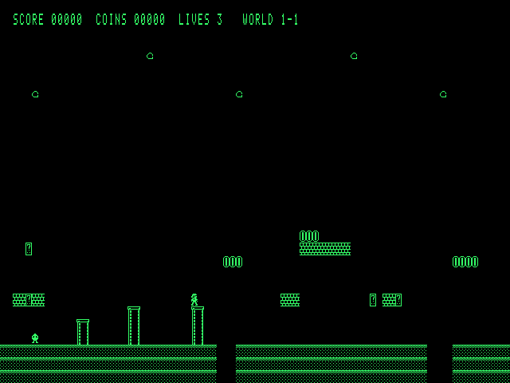

# Open8-VGA

A self-contained 8-bit computer built from 74HC/AC logic chips: a custom microcoded CPU,
32 KiB of RAM, an 80 × 30 VGA text and tile display, a PS/2 keyboard and an EEPROM for
saving programs. It boots straight into a full-screen editor with a built-in assembler, so
you type assembly language on the machine itself and run it, up to games like Tetris and a
scrolling platformer.

**[Try it in your browser →](https://adham404.github.io/Open8-VGA/)** The emulator runs
the real boot ROM, so it is the same machine code the board would run.



Designed by **Adham Elshafei** · adham_mohsen@outlook.com · 2026.
Inspired by Ben Eater's 8-bit breadboard computer.

## Status

Everything is verified in simulation; **no board has been built yet.**

| Area | State | Docs |
|---|---|---|
| Architecture, memory map | done | [01](docs/01-architecture.md) |
| Instruction set (102 instructions), microcode, ROM-based ALU, assembler | done, simulated | [02](docs/02-isa.md) |
| VGA tile controller, PS/2 receiver | done, simulated | [03](docs/03-video-keyboard.md) |
| Boot firmware: editor, on-board assembler, help, examples | done, simulated | [04](docs/04-firmware.md) |
| Tetris, platformer, browser emulator | done, simulated | [05](docs/05-games.md) |
| Save/load to EEPROM (4 slots) | done, simulated | [06](docs/06-eeprom.md) |
| Parts verification and timing budget against datasheets | done | [07](docs/07-parts-timing.md) |
| Netlist, gate-level simulation of the whole board | done, 11 tests | [08](docs/08-board.md) |
| PCB Rev A: 6 layers, routed, design-rule check clean, Gerbers | done, **not fabricated** | [08](docs/08-board.md) |
| Parts list, assembly guide | done | [09](docs/09-assembly.md) |
| Bring-up plan | written, not yet carried out | [10](docs/10-bring-up.md) |
| Compact-Mac-style 3D-printed case with an 8" LCD (FreeCAD) | designed, fit-checked, **not printed** | [enclosure](enclosure/README.md) |

## Quick start

Needs only Python 3.8+ (no packages). Node.js is used by one test.

```sh
./build.sh
```

This builds every ROM image into `build/rom/`, rebuilds the browser emulator
(`web/open8-vga.html`), regenerates the instruction-set doc, and runs the whole test suite.

* Run the emulator locally: open `web/open8-vga.html` in a browser. It is one
  self-contained file and needs no server.
* Assemble a program on your computer: `python3 tools/asm.py prog.asm -o prog.bin --listing prog.lst`
* Run only the tests: `python3 -m unittest discover -s tests`

## Building the hardware

The Rev A board is 313 × 259.5 mm, 6 layers, all through-hole parts (hand assembly), with
the nine flash chips in sockets.

| File | What |
|---|---|
| [`hardware/fab/rev-a/open8-vga-gerbers-revA.zip`](hardware/fab/rev-a/open8-vga-gerbers-revA.zip) | Gerbers and drill files (JLCPCB-ready) |
| [`hardware/fab/rev-a/open8-vga-bom-revA.csv`](hardware/fab/rev-a/open8-vga-bom-revA.csv) | parts list with manufacturer part numbers |
| [`kicad/board/`](kicad/board/) | KiCad 10 project: schematic and routed board |
| [`docs/09-assembly.md`](docs/09-assembly.md) | soldering order, which ROM image goes in which socket, jumpers |
| [`docs/10-bring-up.md`](docs/10-bring-up.md) | staged power-on and test plan |

The ROM images to program into the flash chips come from `./build.sh` (`build/rom/`).
This design has not been built or tested on real hardware; treat Rev A as a first
prototype.

## Repository layout

```
docs/        design notes 01-10, screenshots (02-isa.md is generated)
firmware/    boot firmware in Open8 assembly (main.asm includes the rest; gen/ is generated)
examples/    example programs, all built into the ROM (F5 in the editor)
tools/       ISA definition, ALU and microcode generators, assembler, simulators,
             VGA timing and font generators, firmware and emulator builders
             (web/open8core.js + web/page.html are the emulator sources)
web/         open8-vga.html: the built browser emulator
hardware/    design.py: the board netlist as code; gatesim.py: gate-level simulator;
             lib.py: chip models; kicad_map.py, bom.py; layout/: placement, routing and
             finishing scripts for the PCB; fab/: release fabrication files
kicad/board/ KiCad project for the PCB
enclosure/   3D-printed case: parametric FreeCAD script, STLs, renders
tests/       CPU, assembler, video, keyboard, firmware, games, EEPROM, emulator and
             gate-level board tests
```

## How it is verified

* **CPU:** every opcode, step and flag combination of the microcode is checked against an
  instruction-level reference model; the ALU lookup tables are checked exhaustively.
* **Firmware:** the real flash image boots, edits, assembles and runs programs in the
  simulator; the on-board assembler is byte-identical to the reference assembler.
* **Emulator:** the JavaScript emulator is checked state-for-state against the Python
  simulator.
* **Board:** the full netlist runs at gate level and boots the firmware, draws video and
  reads the keyboard and EEPROM, matching the higher-level simulators.
* **Not yet verified:** a real board, real chip timing (only a datasheet budget so far),
  analog VGA levels, a real keyboard.

## License

[MIT](LICENSE) © 2026 Adham Elshafei. This covers the software, firmware, hardware design
files and documentation.
