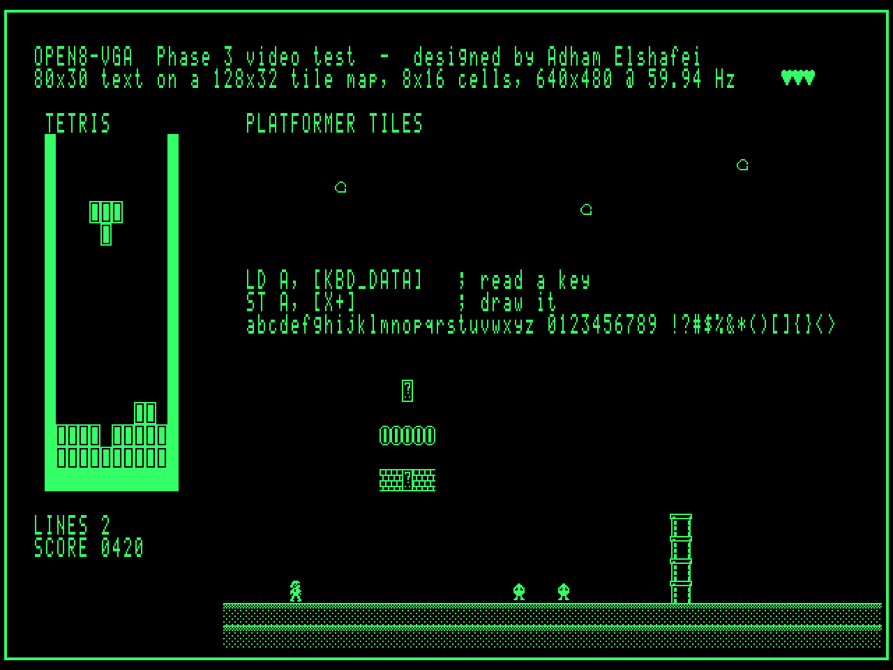

# Open8-VGA — Phase 3: VGA Tile Controller and PS/2 Keyboard

Author: Adham Elshafei <adham_mohsen@outlook.com>
Status: **verified in simulation (cycle/dot-accurate models); not built in hardware.**



*Above: `examples/video_demo.asm`, executed on the microcode-level CPU model, rendered
from VRAM and the default font exactly as the tile pipeline produces it (green tint
jumper, 2× scale).*

---

## 1. Video — what it does

* 640×480 @ 59.94 Hz, 25.175 MHz dot clock, both syncs negative.
* 80×30 visible cells of 8×16 pixels, taken from a **128×32 tile map** (VRAM, 4 KiB)
  with **hardware coarse scroll** in X (0–127 tiles) and Y (0–31 tiles), wrapping.
* 256 glyphs/tiles in **font RAM** (4 KiB), writable by the CPU at any time.
* Monochrome; colour of the "on" pixels chosen by jumpers (white / green / amber).

### CPU interface
| Address | Access | Meaning |
|---|---|---|
| `$6000 + row*128 + col` | R/W | tile map; row 0–31, col 0–127 |
| `$7000 + glyph*16 + line` | R/W | glyph bitmap; bit 7 = leftmost pixel |
| `$5004` SCROLL_X | W | tile-map column shown at the left edge (0–127) |
| `$5005` SCROLL_Y | W | tile-map row shown at the top (0–31) |
| `$5002` SYS_STATUS bit 0 | R | VBLANK latch: set at the start of line 480, cleared by reading |

Writes may happen at any time — no snow, no waiting. For tear-free animation, wait for
VBLANK (1.43 ms = 4 500 CPU cycles of blanking per frame) and update scroll/tiles then.

### Default font (`tools/font.py`, original artwork)
`0` blank · `1–7` blocks and shades · `8–18` box drawing · `19` Tetris block ·
`20` brick · `21` ? block · `22` ground · `23/24` pipe · `25` coin · `26` heart ·
`27` hero · `28` walker enemy · `29` cloud · `30` arrow · `31` underline cursor ·
`32–126` ASCII · `127` checkerboard · `128–255` inverse of `0–127`.
Copied from flash bank page 4 into font RAM at boot.

## 2. Video — hardware

| Ref (prov.) | Part | Function |
|---|---|---|
| X1 | 25.175 MHz 5 V oscillator | dot clock |
| U_DIV | 74AC161 | ÷8 → CHAR CLK (= CPU clock source) + shifter LOAD pulse |
| U_H0–1 | 2× 74HC163 | H counter 0–99 (sync clear from HRESET) |
| U_V0–2 | 3× 74HC163 | V counter 0–524 (counts on HRESET, sync clear on VRESET) |
| U_TROM | SST39SF010A | timing ROM, address `V[9:0] H[6:0]` (`build/rom/vga_timing.bin`) |
| U_TREG | 74HC574 | timing register: HSYNC#, VSYNC#, BLANK, HRESET, VRESET, VBL_START |
| U_SX, U_SY | 2× 74HC574 | scroll registers (I/O writes) |
| U_ADD0–2 | 3× 74HC283 | col + SCROLL_X (7 bit), row + SCROLL_Y (5 bit) |
| U_VRAM | AS6C6264-55 | tile map (4 K of 8 K used) |
| U_VMUX0–2 | 3× 74HC157 | VRAM address: video (φ1) / CPU (φ2) |
| U_VBUF | 74HC245 | VRAM ↔ CPU data bus, enabled in φ2 when `/VRAMCS` |
| U_CHL | 74HC574 | char latch (clocked mid-period, end of φ1) |
| U_FONT | AS6C6264-55 | font RAM |
| U_FMUX0–2 | 3× 74HC157 | font address: `{char, V[3:0]}` (φ1) / CPU (φ2) |
| U_FBUF | 74HC245 | font ↔ CPU data bus |
| U_FL | 74HC574 | font-data latch (mid-period) |
| U_SH | 74AC299 | 8-bit shifter at 25.175 MHz, parallel load each char |
| U_OUT | 74AC244 | pixel AND /BLANK → R, G, B drivers (+ sync buffers) |
| U_VBL | 74HC74 | VBLANK latch |
| glue | 74HC00/08/32 | φ2 strobes, chip selects |

≈ 27 packages. Timing ROM replaces the usual ~10 comparator/flip-flop chips.

### Pipeline (PIPE = 2 character periods)
```
period n    φ1: VRAM[(row+SY)*128 + (h+SX)]  ──► char latch (mid n)
period n+1  φ1: FONT[char*16 + V[3:0]]       ──► font latch (mid n+1) ──► shifter load (end n+1)
period n+2      8 dots out of the 74AC299, gated by registered BLANK
```
The timing ROM table is generated with this delay (and the one-period delay of its own
output register) built in, so HSYNC/VSYNC/BLANK line up with the pixels, not with the
counters.

### Timing ROM output bits (`tools/video.py`)
`b0 HSYNC#` · `b1 VSYNC#` · `b2 BLANK` · `b3 HRESET` · `b4 VRESET` · `b5 VBL_START`.
Unreachable counter states (H ≥ 100, V ≥ 525) assert HRESET/VRESET, so a glitched
counter recovers within one line (tested).

### Arbitration and timing budget
CPU and video share the same clock edge (CHAR CLK). Each 317.8 ns period:
* φ1 (CHAR CLK high, 158.9 ns): muxes select the video address; both RAMs read for video.
* φ2 (CHAR CLK low, 158.9 ns): muxes select the CPU address; `/WE` and the 74HC245 are
  enabled only now, and only if the CPU selected that RAM.

Worst-case path for a **CPU read** of VRAM/font RAM (starts at the φ2 edge, ends at the
register setup before the next rising edge). The figures below are representative
74HC datasheet values at 4.5 V; **they must be confirmed against the exact datasheets
in Phase 6**:

| Step | Typ. | Max (25 °C) | Max (85 °C) |
|---|---|---|---|
| 74HC157 select → output | 14 ns | 38 ns | 47 ns |
| SRAM address access (AS6C6264-55) | — | 55 ns | 55 ns |
| 74HC245 A → B | 9 ns | 22 ns | 28 ns |
| 74HC574/377 setup | 5 ns | 20 ns | 25 ns |
| **Total vs 158.9 ns** | | **135 ns (24 ns margin)** | **155 ns (4 ns margin)** |

Conclusion: works at room temperature, marginal hot. **Mitigation adopted:** the six
address muxes and two data buffers in this path use **74AC157 / 74AC245** (≈ ⅓ the
delay), giving > 70 ns margin; the half-speed CPU jumper remains as a fallback.
Video-side reads (φ1) have the same path minus the 245 and are not critical.

## 3. PS/2 keyboard — hardware

| Ref (prov.) | Part | Function |
|---|---|---|
| J_KBD | mini-DIN-6 female | 1 DATA, 3 GND, 4 +5 V, 5 CLK |
| F_KBD | 200 mA polyfuse | keyboard supply |
| R | 2× 4.7 kΩ | CLK, DATA pull-ups |
| U_ST | 74HC14 | Schmitt input on CLK (and DATA); timeout comparator |
| U_SR0–1 | 2× 74HC164 | 11-bit serial-in shift register, clocked on falling CLK |
| U_BC | 74HC161 | bit counter; terminal count at 11 sets READY |
| U_RDY | 74HC74 | READY flip-flop |
| U_INH | 74HC05 | open-drain: holds CLK low while READY (keyboard waits) |
| U_KD | 74HC541 | data byte → CPU bus (`$5000`) |
| U_KS | 74HC541 | status → CPU bus (`$5001`) |
| R/C | 47 kΩ / 47 nF + diode | ~2 ms CLK-idle timeout → clears a partial frame |

### Protocol handling
* Frame: start 0, 8 data bits LSB first, odd parity, stop 1; 10–16.7 kHz clock driven by
  the keyboard. Bits are sampled on the falling CLK edge.
* After 11 bits the receiver sets READY and **inhibits** the keyboard (CLK low). The
  keyboard holds further bytes in its own buffer, so a slow CPU never loses a byte.
* Reading `$5000` returns the byte and clears READY + counter, releasing CLK.
* `$5001`: `b0 READY`, `b1 parity`, `b2 start`, `b3 stop` — firmware checks
  `start=0, stop=1, odd parity` and discards bad frames (noise).
* If the keyboard's own buffer overflows it sends `$00` (overrun); the driver ignores it.
* A USB keyboard works only if it supports PS/2 mode through a passive adapter.

### Scan codes
The driver uses Scan Code Set 2 (make code; `F0` + code for release; `E0` prefix for
arrows, Home/End, PgUp/PgDn, Insert/Delete, right Ctrl/Alt). The reference decoder
`tools/ps2.Decoder` is the golden model the firmware driver will be tested against;
it tracks a key-down set (games read held keys) and produces characters/editor keys.
Code table: `tools/ps2.py` (`KEYS`, `SHIFTED`, `SPECIAL`, `EXTENDED`) — **to be checked
against a real keyboard at bring-up.**

## 4. Verification performed (`tests/test_video_keyboard.py`)
| Check | Result |
|---|---|
| Line = 800 dots, HSYNC low 96 dots, front porch 16, back porch 48 (measured on the simulated dot stream) | pass |
| Frame = 525 lines, VSYNC low 2 lines, exactly 640×480 un-blanked dots per frame, 59.94 Hz | pass |
| Image reconstructed *from the sync pulses only* (as a monitor does) equals the reference renderer, with scroll (9, 4) and random VRAM | pass |
| Negative control: timing ROM built for the wrong pipeline delay → image mismatch detected | pass |
| Scroll wrap in X (col 120 → left edge) and Y (row 31 → top) | pass |
| CPU write in φ2 to the cell being fetched in φ1 of the same period: video sees the old value, write lands | pass |
| Counters forced into illegal states recover within 3 lines | pass |
| All 256 byte values through keyboard → receiver; start/stop/parity status correct | pass |
| Slow CPU (reads every 6 ms): inhibit loses nothing | pass |
| Keyboard buffer overflow → 16 bytes then `$00` | pass |
| Noise pulse then idle > timeout → next byte correct; noise inside a frame → frame error detectable | pass |
| Text with shifted symbols + arrow + F1 → scan codes → decoder → identical text/events, no stuck keys | pass |
| **Integrated:** assembly program polls KBD, prints `1C F0 1C` after typing "a" | pass |
| **Integrated:** assembly program waits for 3 VBLANKs → 2–3.1 frames of cycles elapsed | pass |

Not yet verified: analogue VGA levels on a real monitor, real keyboard timing/scan codes,
74xx propagation delays (gate-level simulation, Phase 5), signal integrity (PCB, Phase 6).
