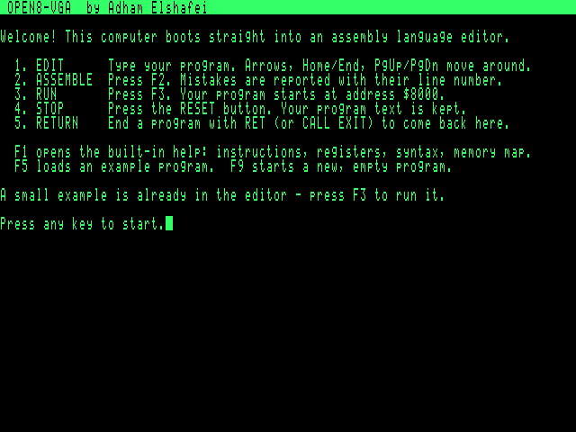
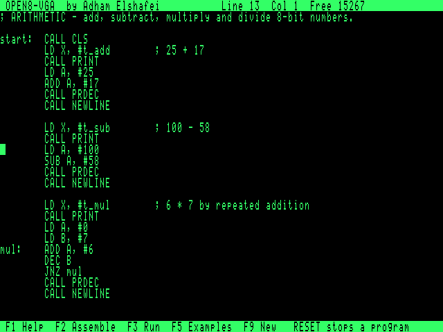
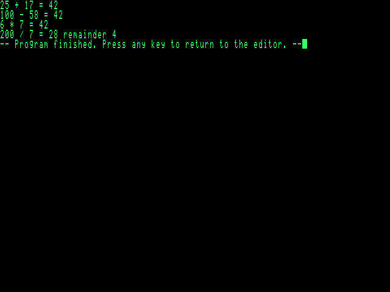
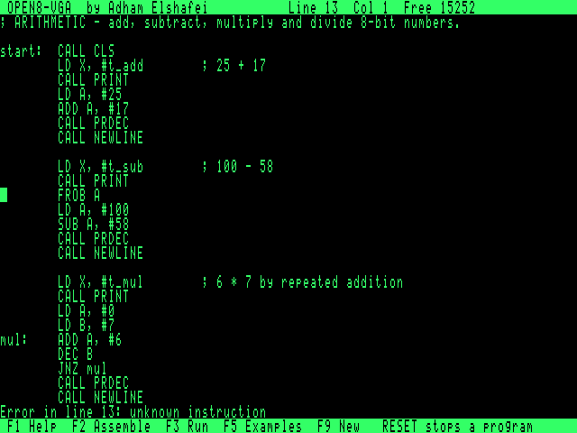
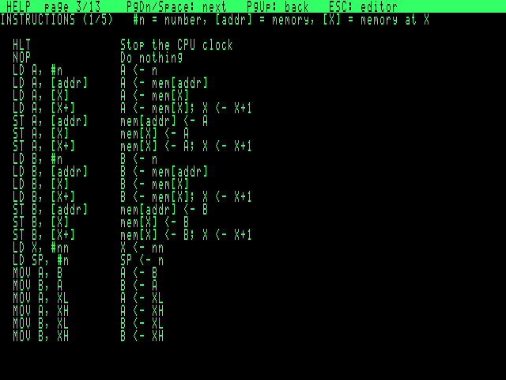
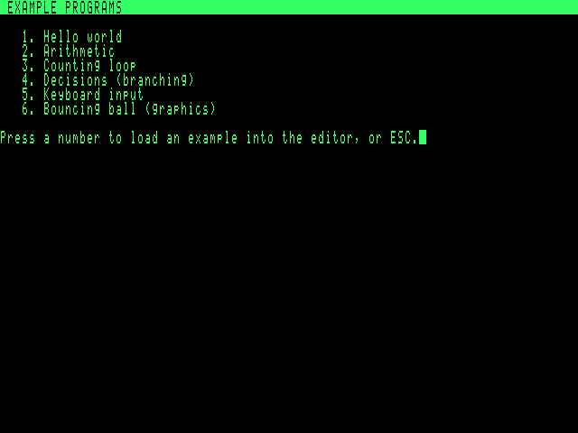

# Open8-VGA — Phase 4: Boot Firmware, Editor and On-board Assembler

Author: Adham Elshafei <adham_mohsen@outlook.com>
Status: **runs in simulation from the real flash image; not yet run on hardware.**

All firmware is Open8 assembly (`firmware/*.asm`, ≈ 3 000 lines), built into
`build/rom/firmware.bin` by `python3 tools/build_firmware.py`. Every screenshot below
is rendered from VRAM of the simulated machine executing that image.

| Welcome (cold boot) | Editor |
|---|---|
|  |  |
| **Program output (F3)** | **Assembly error (F2)** |
|  |  |
| **Built-in help (F1)** | **Example programs (F5)** |
|  |  |

## 1. The workflow on the machine
1. **Power on** → welcome screen with the five-step workflow; an example is already loaded.
2. **EDIT** — full-screen editor: arrows, Home/End, PgUp/PgDn, Backspace, Delete, Enter, Tab.
3. **ASSEMBLE (F2)** — "Assembled OK: N bytes at $8000", or "Error in line N: …" with
   the cursor moved to that line.
4. **RUN (F3)** — assembles, clears the screen, `CALL $8000`.
5. **STOP** — the RESET button. Source text survives (warm boot, "your text is safe").
6. **RETURN** — `RET` or `CALL EXIT` → "Program finished. Press any key" → editor.

Other keys: **F1** 13-page manual · **F5** example picker · **F9** new program (asks Y/N).

## 2. Flash image (SST39SF010A, 128 KiB)
| Pages | Window | Content | Used |
|---|---|---|---|
| 0–3 | `$0000–$3FFF` | boot, runtime, keyboard driver, editor, assembler, help viewer, strings, key maps | **8.8 KB of 16 KB (53 %)** |
| 4 | bank | font (256 × 8×16) | 4 KB |
| 5–7 | bank | help text, 13 pages | 11.2 KB |
| 12 | bank | assembler tables: instructions, aliases, directives, 67 predefined names, hash slots | 2.7 KB |
| 13 | bank | example directory | |
| 14–19 | bank | six example programs (source text) | |
| 20–31 | — | free (≈ 48 KB) for Tetris, the scroller demo, more help | |

The instruction table, key maps and predefined names are **generated** from `isa.py`,
`asm.py` and `ps2.py`, so the on-board assembler cannot drift from the hardware.

## 3. Runtime routines (jump table at `$0003 + 3n`, names predefined in both assemblers)
`PUTC PRINT CLS GOTOXY GETKEY KEYHIT KEYDOWN PRHEX PRDEC WAITVBL EXIT RANDOM DELAY
NEWLINE PRDEC16`. Convention: A = argument/result; B and X preserved (PRINT advances X).
The console scrolls with the hardware SCROLL_Y register (no copying).

## 4. Keyboard driver
Scan Code Set 2, with E0/F0 prefixes, Shift, Caps Lock and Ctrl. Each byte is checked for
start/stop/odd parity (noise is dropped). A 128-bit held-keys map serves `KEYDOWN`. After a
prefix the driver waits up to 2 ms for the rest of the sequence, so a press or release is
never split across two calls. Key codes: ASCII; `K_UP…K_F12` ≥ `$80`.

## 5. Editor
* **Gap buffer** in protected RAM `$B000–$EFFF` (16 KB). Insert/delete is O(1) anywhere,
  and the cursor moves the gap. (A plain buffer would need ~200 ms per keystroke near the
  top of a large file: system RAM can only be written by ROM code, so no fast RAM-resident
  copy loop is possible.)
* Screen: status bar (line, column, free bytes), 27 text rows, message row, key bar.
* Redraw: only the cursor line while typing (≈ 8 ms per key including the PS/2 transfer);
  full screen for line changes (≈ 27 ms).
* Lines are limited to 79 characters while typing.

## 6. On-board assembler
* Two passes over the text; nothing is written to `$8000+` unless pass 1 succeeds.
* Same syntax as the cross-assembler **except** expressions are limited to `+ - < > $`
  (no `* / & |` or parentheses), names ≤ 20 characters, `.equ` not supported (use `=`).
* Symbols: 128-slot hash table (24 bytes per slot) + 67 predefined names in ROM.
* Name comparisons put SP on the name buffer and read it with `POP`, so X can walk the
  other string — about 14 cycles per character.
* Speed: a 300-line program (8.8 KB of text) assembles in **2.25 s**; the examples in
  0.06–0.4 s. Errors: unknown instruction, invalid operands, undefined name, duplicate,
  value too large, program too large (≥ `$AF00`), table full, syntax, bad number, name
  too long, unknown directive, forward reference in `.ds`/`.org`, reserved word.

## 7. Safety behaviour
| Situation | What happens | Tested |
|---|---|---|
| Program ends with `RET` / `CALL EXIT` | "Program finished", key, editor | yes |
| Endless loop | RESET → warm boot, text kept, "machine was reset" | yes |
| Invalid opcode (e.g. data executed) | hardware trap → "Invalid instruction at $8001" | yes |
| Write to `$B000–$FFFF` from user code | blocked by hardware; "tried to write to protected system memory" | yes |
| `HLT` | clock stops; CONTINUE or RESET | microcode tested (Phase 2) |
| Garbage in SRAM at power-on | pointer sanity check fails → cold boot | by construction |

## 8. Verification (`tests/test_firmware.py`, 25 tests, all passing)
* **On-board vs reference assembler, byte-identical**: all 6 examples; every one of the
  102 instruction forms plus aliases in one program; literals/escapes/directives/.org;
  12 random 60-line programs with forward references, constants, `.db`/`.dw`.
* **Error parity**: 19 malformed programs give an error on the same line as the
  reference assembler; 10 error codes checked.
* **Symbol table**: 128 names fit, the 129th gives "too many names" on line 129.
* **Editor**: a 220-step random editing session (typing, Enter, Backspace, Delete, arrows,
  Home/End) compared against a Python model after every key — text and cursor identical;
  60-line scrolling and PgUp; typing a program, F2, F3, output, return with source intact;
  error jumps to the line.
* **Recovery**: RESET from an endless loop, invalid-instruction trap, protected-memory write.
* **Help**: all 13 pages reached with PgDn, ESC returns. **Examples**: each of the 6 loaded
  through F5 and run, with expected output (keyboard echo and bouncing ball driven by keys).
* **Runtime**: PRDEC16/PRHEX values, console hardware scroll, GETKEY codes (letters,
  shifted symbols, arrows, F-keys, Delete/Insert), Caps Lock, Ctrl, KEYDOWN press/release,
  RANDOM spread, noise frames ignored.
* **Cycle-accurate run**: boot → editor → F3 on the **microcode-level** CPU executing the
  generated control ROM.

Not verified: real hardware, real PS/2 keyboards, monitor display, EEPROM save/load (not
implemented yet), Tetris and the scrolling platformer (next).

## 9. Known limitations
* SAVE/LOAD was added after this phase: see [06-eeprom.md](06-eeprom.md).
* No undo, no search, no copy/paste; lines up to 79 characters.
* On-board expressions are simpler than the cross-assembler's (see §6).
* A program in an endless loop can only be stopped with RESET (no interrupts).
