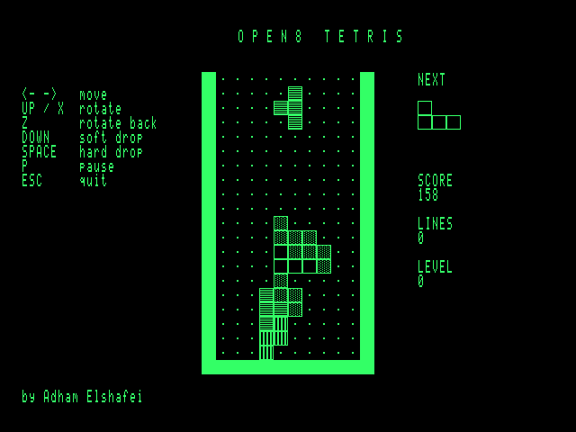

# Open8-VGA — Games and the Browser Emulator

Author: Adham Elshafei <adham_mohsen@outlook.com>
Status: **both games assemble on the machine and play in simulation and in the browser
emulator; not yet run on hardware.**

| Tetris (example 7) | Open8 Runner (example 8) |
|---|---|
|  |  |

Both are ordinary Open8 assembly programs, stored as examples in the boot ROM. To play
on the machine: **F5 → 7 (or 8) → Y → F3**. The machine's own assembler builds them
(Tetris 5.2 s, Runner 7.8 s at 3.15 MHz) and the game starts. ESC returns to the editor.

## Tetris — `examples/07_tetris.asm`
* 10×20 field drawn with 2×1 tiles per cell (16×16 px squares). The game builds 16 tiles
  in font RAM at start: an empty cell and a different fill pattern for each of the 7
  pieces, so pieces stay distinguishable on a monochrome screen.
* All 7 tetrominoes with 4 rotations, wall kicks (0, −1, +1, −2, +2), next-piece preview,
  soft drop, hard drop (2 points per row), pause, line clears with 40/100/300/1200 points,
  a level every 10 lines, 20 gravity speeds.
* Board in RAM at `$9000`, 16 bytes per row with 2-wide walls (index = row×16 + column).
* A full redraw takes about 30 000 cycles, 57 % of one 60 Hz frame.
* 116 names, 12 KB of source (TAB-compressed), 2.3 KB of machine code.

## Open8 Runner — `examples/08_platformer.asm`
* A 255-column level: ground with pits and a raised step, pipes, brick and ? blocks,
  coins, 18 walkers, a staircase and a flag pole. Three lives, score, coin count.
* **Hardware scrolling**: SCROLL_X moves the 80-column view across the 128-column tile map
  as a ring. Each time the camera advances a column, the column 81 places ahead is
  generated (sky, clouds, ground runs, objects) into the off-screen part of the ring.
  The status line is redrawn at the scrolled position.
* **Collision map**: a RAM copy of the tile map at `$9000` (same layout as VRAM). Physics
  reads it, so the hero and walkers can be drawn into VRAM and erased by copying the map
  tiles back.
* Physics in 8.8 fixed point: run speed 48/256 tile per frame, jump −110/256 row per frame,
  gravity 7, falling speed limit. Moving into solid tiles stops at the tile edge. Head
  bumps turn ? blocks into used blocks and give a coin.
* Walkers turn at walls and platform edges, are removed off-screen, and die when stomped
  (+100, the hero bounces). Touching one from the side, or falling into a pit, costs a life.
* Builds its own tiles at start: a mirrored hero for running left, a flag, and pipe bodies.
* Coarse scroll only (8-pixel steps) and tile-sized sprites: deliberate limits of this video
  hardware.
* 171 names, 14.9 KB of source, 2.5 KB of machine code.

## Changes the games needed
| Change | Why |
|---|---|
| Editor shows TAB characters at 8-column stops; Tab inserts a TAB; ROM examples are TAB-compressed (and checked to expand back exactly) | Tetris was 17 KB with spaces, above the 16 KB editor buffer |
| On-board symbol table: 192 slots × 16 bytes (names ≤ 14 chars) instead of 128 × 24 | the platformer has 171 names |
| PS/2 keyboard model re-sends a byte the host interrupted (PS/2 rule) | a noise pulse could lose a key |
| Driver waits up to 2 ms for the rest of an E0/F0 sequence | so a press or release is never split across two KEYDOWN calls |

## Browser emulator — `web/open8-vga.html`
* Built by `python3 tools/build_web.py`; one 208 KB HTML file with the flash image embedded.
* `tools/web/open8core.js` is a line-by-line port of the instruction-level CPU, memory map,
  I/O, bit-level PS/2 keyboard and the frame/vblank timing of the Python simulator.
* **Cross-check** (`tests/test_web.py`): a 31.7 M-cycle session (boot, F5 7 Y, the machine
  assembles Tetris, scripted play, ESC) runs in both; a hash of all registers and 40 KB of
  RAM matches at all 634 checkpoints.
* Physical keys are sent as real set-2 make/break codes; on-screen key caps cover function
  keys and game controls for touch screens. RESET keeps the program text, POWER clears
  memory, 1×/4×/16× clock, green/amber/white phosphor. SRAM is kept in the browser between
  visits, like a battery-backed board.

## Tests (`tests/test_games.py`, 19 tests)
Tetris: empty board and walls, gravity, walls stop movement, rotation, hard-drop scoring,
single and four-line clears with scoring, level-up after 10 lines, game over with restart
and quit, full redraw within one frame. Runner: level layout and spawns, jump and landing,
pipe blocks running, then jump over it with the camera and SCROLL_X following, ? block
bump, coin pickup, stomp, losing a life to a walker and restarting, falling into a pit,
reaching the flag ("COURSE CLEAR"). Both games also assemble byte-identically with the
on-board assembler (`tests/test_firmware.py`).
