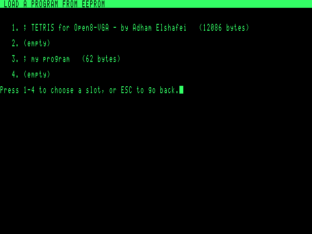

# Open8-VGA — SAVE / LOAD on the 25LC512 EEPROM

Author: Adham Elshafei <adham_mohsen@outlook.com>
Status: **works in simulation against a model of the chip; not yet tested on hardware.**

## Use
* **F4 SAVE**: shows the 4 slots (first line and size of each saved program). Press 1–4.
  An occupied slot asks before it is replaced. The editor text and cursor do not change.
  The message reads e.g. "Saved 12086 bytes, slot 1."
* **F6 LOAD**: same screen. Press 1–4, then Y to replace the editor text.
* The EEPROM keeps its contents without power; RESET and power-off do not affect it.

## Hardware
| 25LC512 pin | Signal | Open8 connection |
|---|---|---|
| 1 /CS | chip select | OUT_PORT bit 2 (`$5006`) |
| 2 SO | data out | IN_PORT bit 0 (`$5007`), 10 kΩ pull-up |
| 3 /WP | write protect | +5 V (not protected) |
| 4 VSS | ground | GND |
| 5 SI | data in | OUT_PORT bit 1 |
| 6 SCK | clock | OUT_PORT bit 0 |
| 7 /HOLD | hold | +5 V |
| 8 VCC | supply | +5 V, 100 nF to GND |

DIP-8 in a socket (U_EE). SPI mode 0, MSB first, bit-banged by the CPU, so the clock runs at
about 60 kHz, far below the chip's 20 MHz limit. The pull-up on SO makes an empty socket read
as `$FF`. The firmware checks for that and reports "No EEPROM found". At reset the
firmware drives /CS high.

## Slot format
64 KiB = 4 slots × 16 KiB, slot *n* at `n × $4000`:
`'O' '8' length-low length-high` followed by the text (LF line ends, TABs kept).
The maximum text is 16 380 bytes. A longer text is refused ("Too long to save"), and
nothing is written.

## Firmware (`firmware/eeprom.asm`, ≈ 1.5 KB)
* `spi_byte`: one byte out and one in, 8 × (SCK low with MOSI, SCK high, sample MISO).
* Writes: WREN, then WRITE with an address and up to 128 bytes, in pages aligned to 128-byte
  boundaries. Raising /CS starts the chip's 5 ms write cycle, and the next page waits for
  RDSR's WIP bit to clear.
* The gap buffer is closed (gap moved to the end) so the text is one block, then the
  cursor is put back.
* **Every save is read back and compared.** Only then does the editor say "Saved". A
  mismatch or a chip that never becomes ready gives "EEPROM write failed - the program
  was NOT saved."
* Loads stream the text with one READ command, straight to the end of the gap buffer, so
  the cursor starts at the top.
* Timing at 3.15 MHz: a 16 KB program saves in **6.5 s** (128 pages × 5 ms plus SPI
  and verification) and loads in **2.7 s**. A typical 1–2 KB program takes well under a second.

## Model (`tools/eeprom.py`, mirrored in `tools/web/open8core.js`)
Covers READ, WRITE, WREN, WRDI, RDSR (WRSR accepted and ignored). Modelled: WEL latch,
128-byte page wrap, a write that only happens on a complete frame, 5 ms busy time with
only RDSR answered, `$FF` erased state.

## Tests (`tests/test_eeprom.py`, 10 tests, all passing)
* Model: erased reads, status, a WRITE without WREN is ignored, the 5 ms busy window,
  page wrap, reads that do not wrap, a frame cut short does not write.
* Firmware: save → power-cycle (SRAM lost) → load → identical text, and it assembles and
  runs; four independent slots listed by first line; refusing an overwrite keeps the old
  program; empty slot; a 15 953-byte program round trip; a 16 381-byte text is refused with
  no writes; no chip fitted; a chip that drops writes is detected by verification.
* The browser emulator's EEPROM is part of the JS-vs-Python state hash. The 61 M-cycle
  cross-check saves Tetris, clears the editor and loads it back.

In the browser emulator the EEPROM contents are kept in the browser's local storage and
survive the POWER button, as the real chip would.
