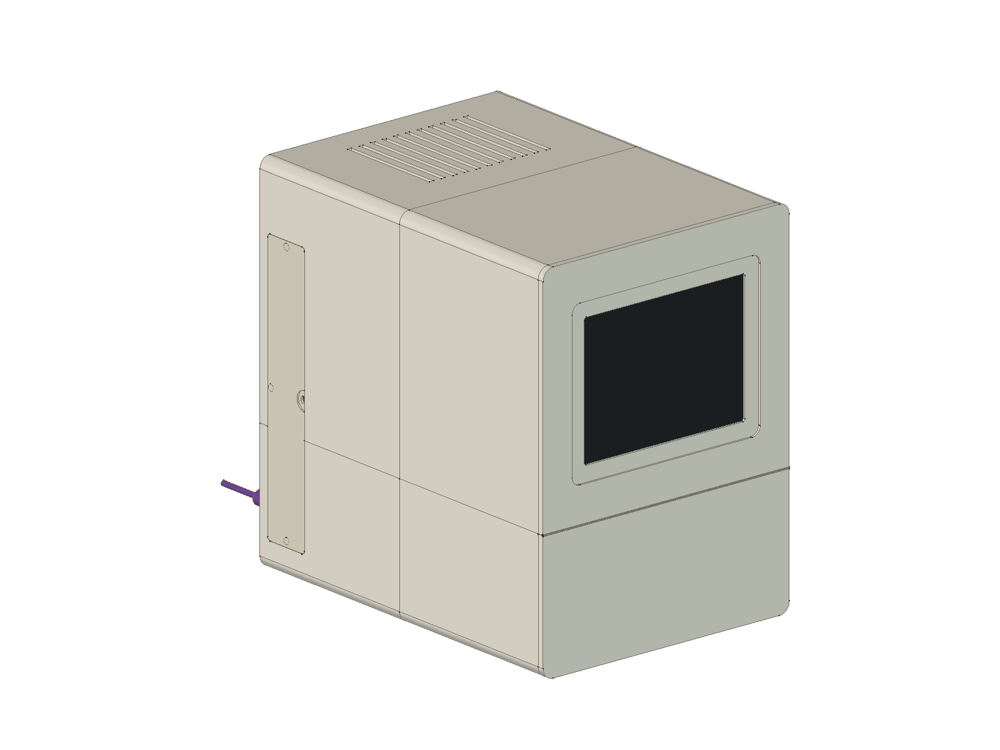
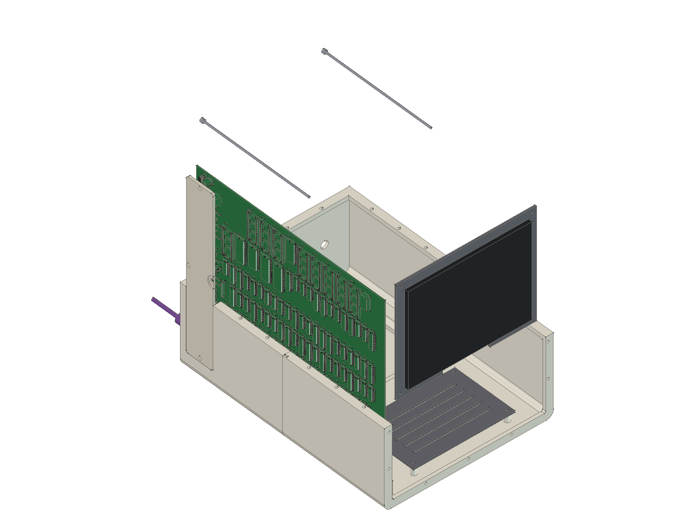
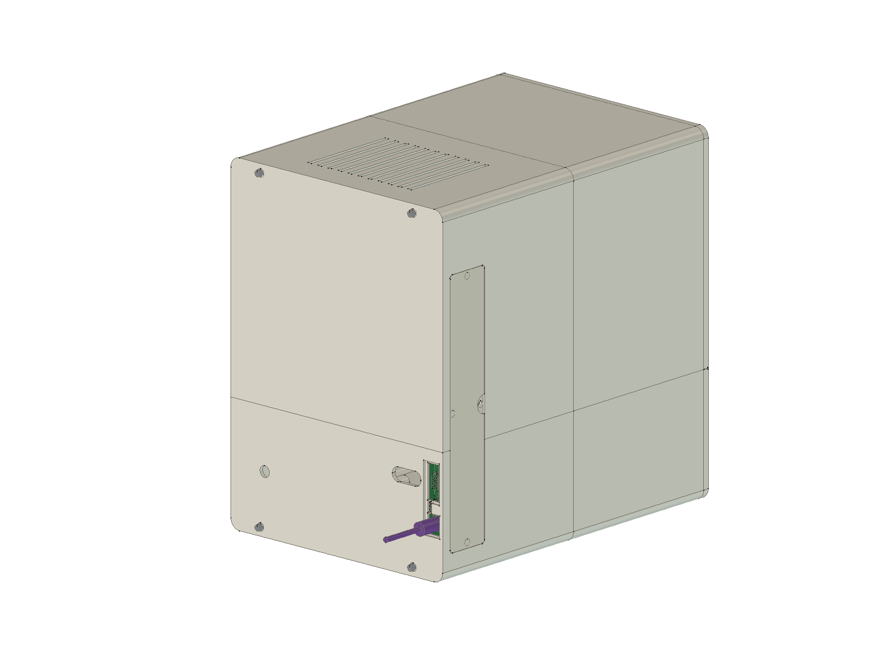
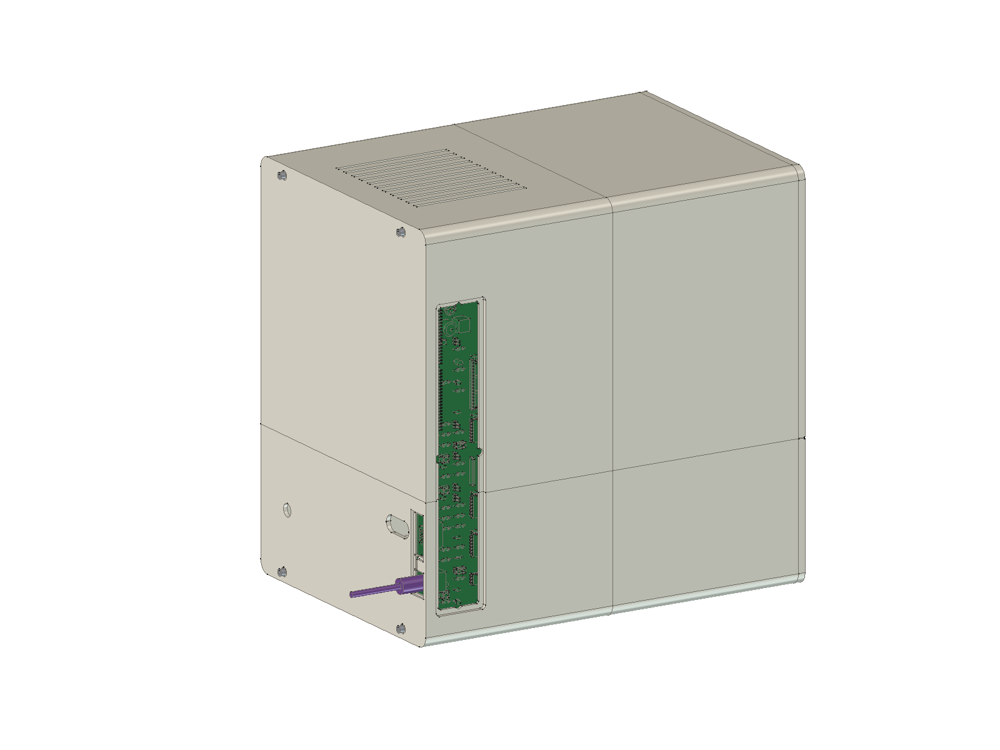
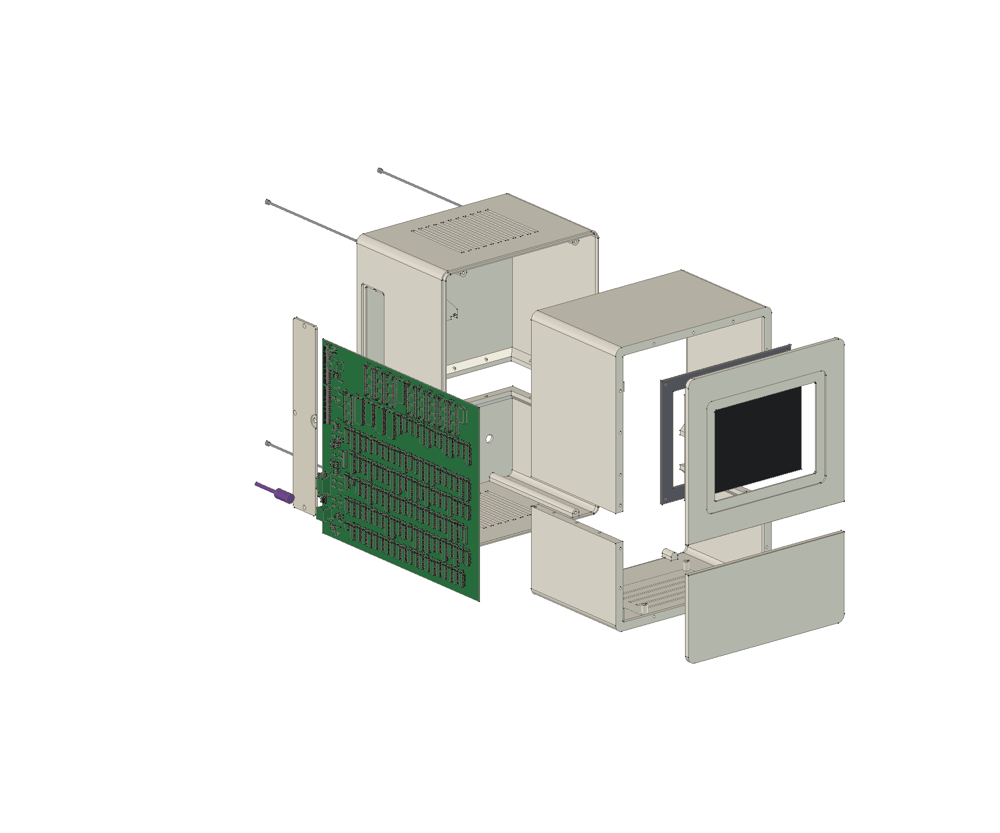

# Open8-VGA enclosure

A compact-Macintosh-style case for the Rev A board and an 8" LCD, designed in FreeCAD.



Author: Adham Elshafei. **Status: designed and fit-checked in CAD only; not yet printed.**

## What it is

| | |
|---|---|
| Outside size | 250 W × 340 H × 345 D mm |
| Screen | 8" 800 × 600, 4:3 (see below), behind a recessed bezel |
| Board | stands upright on the left wall, components facing out, held top and bottom in printed card-guide rails (Rev A has no mounting holes) |
| Controls | a removable magnetic door in the left wall opens onto the board's control strip: RESET, STEP, CONTINUE, both slide switches, all jumpers, the slow-clock trimmer, the PWR/HALT LEDs and the logic-analyser and expansion headers |
| Ports | back panel: VGA, USB-C power and PS/2 keyboard openings in line with the board's connectors, a slot for the VGA loop cable, a 12 V jack for the display. The keyboard plugs straight into J1 from the back (J1's opening sits 4.2 mm in from the board edge, too close to the wall for a cable inside) |
| Printing | 9 parts, every one fits a 256 × 256 × 256 mm bed, none needs supports |

| Inside | Back (ports) | Controls door off |
|---|---|---|
|  |  |  |

## How the parts go together



The shell is printed as four quarters, split at the chin line and at mid-depth. They make
two halves that are each finished on their own, then joined:

* **Chin line** (horizontal seam): each half's lower and upper quarter bolt together through
  the seam lips on the inside, M3 × 14 into inserts. You reach them through the open face of
  that half, so they are done before the halves meet.
* **Mid-depth** (vertical seam): no bolts at the seam itself. The rear half's walls carry a
  5 mm tongue (the inner part of the wall, 1.5 mm thick) that slides into a matching rebate
  in the front half, so the outside stays one smooth surface and the walls line up. Four
  M3 rods run from the back panel through tubes along the base and top of the rear half
  into inserts in bosses in the front half, and acorn nuts on the back pull the halves
  together. The tubes also take the clamping load, so the thin walls are not squeezed.

## Files

| File | |
|---|---|
| `build_enclosure.py` | the parametric model: every dimension is a named setting at the top |
| `out/*.stl` | the 9 printable parts |
| `out/open8-vga-enclosure.FCStd` | FreeCAD document: all parts plus the board and the LCD as reference models |
| `out/open8-vga-enclosure.step` | the case and panel as STEP, for other CAD tools |
| `out/fit_report.txt` | part sizes, overlap check, hardware counts |
| `render_views.py` | renders `out/img/` (opens the FreeCAD window briefly) |
| `render_exploded.py` | renders `out/img/exploded.png` |

Regenerate (FreeCAD 1.1 at `/Applications/FreeCAD.app`, KiCad 10):

```sh
kicad-cli pcb export step --subst-models -o build/enclosure/open8-vga-board.step kicad/board/open8-vga-motherboard.kicad_pcb
enclosure/run_freecad.sh enclosure/build_enclosure.py
/Applications/FreeCAD.app/Contents/MacOS/FreeCAD enclosure/render_views.py
/Applications/FreeCAD.app/Contents/MacOS/FreeCAD enclosure/render_exploded.py
```

The build places the real board model (every component, from KiCad) and the LCD in the
case, along with the join rods, and checks that nothing overlaps, including each tongue in
its rebate: the last run reports 0.000 mm³ for every pair. The
case keeps at least 1 mm from every component automatically, so the seam lips and rails
are notched wherever a tall part needs room.

## The LCD panel

**8" 800 × 600 TFT, Innolux AT080TN52-class**, sold as a kit with a VGA/HDMI driver board
(for example BuyDisplay's 8" 800 × 600 kit with VGA, HDMI and AV inputs, about US$47 with a
12 V adapter; similar kits are on AliExpress).

* Outline 183.0 × 141.0 × 5.6 mm, active area 162.0 × 121.5 mm, 4:3.
* Why: it is the commonly available 4:3 8" panel that ships with a VGA driver board.
  Native 640 × 480 LED-backlit panels exist (Mitsubishi AA084VJ11 class) but are hard to
  source; this one scales 640 × 480 by 1.25×, so text is slightly soft.
* **Before printing, check your panel's drawing** against `PANEL_*` and `ACTIVE_*` in
  the script, especially `ACTIVE_DX` / `ACTIVE_DZ` (where the visible area sits inside
  the outline; the model assumes centred) and which edge the flex cable leaves from
  (`FPC_NOTCH_W`, at the bottom).

## Shopping list

| Qty | Part |
|---|---|
| 1 | 8" 800 × 600 LCD kit with a VGA driver board and 12 V adapter (above) |
| 1 | VGA cable, male–male, about 30 cm, ideally with one right-angle plug |
| 1 | panel-mount 5.5 × 2.1 mm DC jack (11 mm hole) for the display's 12 V |
| 46 | M3 brass heat-set inserts, 5 mm long, for 4.0 mm holes |
| 16 | M3 × 14 bolts (chin-line seam) |
| 18 | M3 × 10 bolts (bezel) |
| 4 | M3 threaded rod, 180 mm (cut from 1 m stainless rod), with 4 M3 washers and 4 M3 acorn nuts (mid-depth join) |
| 8 | M3 × 8 bolts (panel clamp 4, driver tray 4) |
| 8 | neodymium magnets 6 × 3 mm (door) |
| 4 | rubber feet, 12 mm |
| | thin foam tape (0.5 mm) to cushion the LCD glass in the bezel |

## Printing

* PETG or ASA (the inside runs warm: about 5 W of logic plus the backlight; PLA can creep).
* 0.2 mm layers, 4 perimeters, 15–20 % infill. The walls are 3.5 mm, so the case is about
  2,500 cm³ of plastic, **roughly 3 kg of filament**. `T` (wall thickness) at 2.5 mm brings
  it to about 2.2 kg, at some cost in stiffness.
* Orientation: lower shell quarters upright (base on the bed); upper quarters upside down
  (top on the bed); bezel parts face-down; door, clamp and tray flat. Every overhang is
  45° or less.

## Assembly

1. Press the heat-set inserts in with a soldering iron: chin-line seam lips (lower
   quarters), the four rod bosses (front lower and upper quarters, from the split face),
   the bezel rim and clamp bosses, the driver-tray posts.
2. Glue the magnets into the door ledge and the door (check the polarity first).
3. **Front half.** Bolt the front upper quarter onto the front lower quarter (chin line,
   M3 × 14, reached through the open back). Bezel and chin onto the front lip (M3 × 10,
   from inside). LCD: foam tape on the bezel pocket, panel in, clamp frame on (M3 × 8).
   Driver board on the tray (slots fit most hole patterns), tray onto its posts (M3 × 8).
4. **Rear half.** Bolt the rear upper quarter onto the rear lower quarter (chin line,
   M3 × 14, reached through the open front). Fit the 12 V jack in the back panel.
5. Slide the board into the rear half's rails from the front, connectors through the back
   panel.
6. Wiring, while the halves are still apart: VGA from J2 out of the back panel, back in
   through the loop slot, to the driver board; 12 V jack to the driver board. Leave the
   cables that cross the seam slack enough to reach.
7. Slide the front half on: its rails take the front of the board, and the rear half's
   tongue goes into the front half's rebate. Push the four rods in from the back panel,
   thread them into the front inserts, then a washer and acorn nut on each; tighten evenly
   until the seam closes, no further.
8. Door on, feet on.

To open it again, take off the four acorn nuts, unscrew the rods and pull the halves
apart.

## To check on real parts

* The LCD drawing (above) and the driver board's size (the tray takes up to about
  110 × 90 mm).
* Your keyboard's PS/2 plug: the board lies under the plug, so its moulding can be at most
  13 mm thick across the board (most are 12–13 mm round); the opening allows 16 × 18.4 mm.
* The 3D models for the PS/2 jack (J1) and trimmer (RV1) are stand-in boxes; KiCad has no
  model for them. Leave a little extra room around them, or measure the real parts.
* Print one chin-line seam corner, a short test of the tongue and rebate (`TONGUE_GAP`,
  0.2 mm per side) and the door first, to check insert holes and fits on your printer
  before committing 3 kg of filament.
